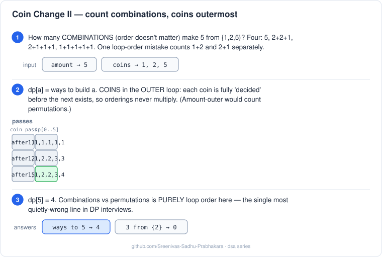

# Coin Change II

> NeetCode 150 · 2-D DP — count combinations, not permutations: the loop ORDER is the semantics, coins outside so each multiset is built in one canonical order. Go, stdlib only, tested.

## Problem

How many distinct coin *combinations* (unordered multisets, unlimited supply) sum to the amount? `5` from `{1,2,5}` → 4 ways. Min-coins was dsa-178; this is the counting sibling.

## Approach

One row `dp[a]` = combinations for amount a, seeded `dp[0] = 1` (the empty combination). The entire problem lives in the nesting: iterating **coins outer, amounts inner** means every combination is constructed in one fixed coin order — 1-then-2 is counted, 2-then-1 can never form — so multisets are counted once. Swap the loops (amounts outer) and the same code counts *permutations* (the "combination sum IV" problem). Two problems, identical bodies, one transposition apart: the sharpest illustration in all of DP that iteration order is part of the algorithm's meaning.

**Complexity:** O(coins · amount) time, O(amount) space.

## Visual walkthrough

Read the picture top to bottom — each numbered frame is one moment of the algorithm
running on this repo's test example.

## Run

    go test ./...   # verify
    go run .        # demo

---

Part of a 275-repo DSA series in Go — Striver's SDE Sheet (dsa-001–191) plus the NeetCode 150 / Blind 75 additions (dsa-192–275), stdlib only, every solution tested. Browse: [`dsa-*` repos](https://github.com/Sreenivas-Sadhu-Prabhakara?tab=repositories&q=dsa-&type=source).
